<p align="center">
  <a href="https://abh2050.github.io/enterprise-ai-control-plane/">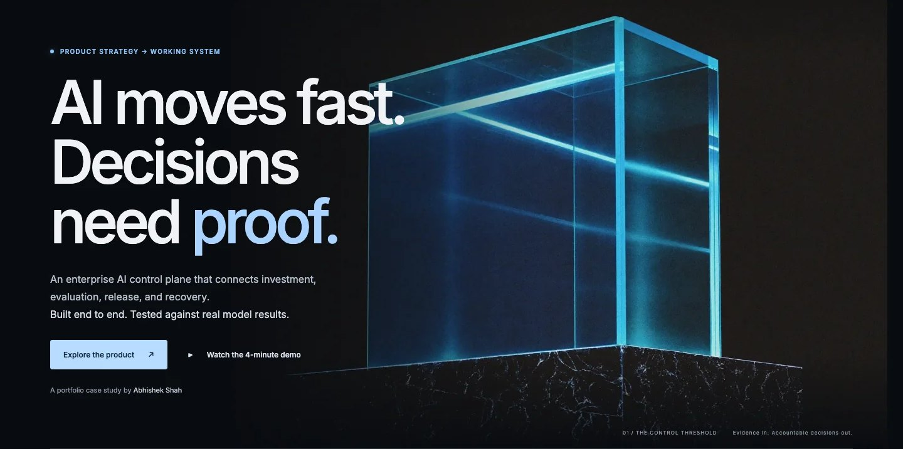</a>
</p>

<p align="center">
  <a href="https://github.com/abh2050/enterprise-ai-control-plane/actions/workflows/ci.yml"></a>
  <a href="https://abh2050.github.io/enterprise-ai-control-plane/console/"></a>
  <a href="data/manifest.json"></a>
  <a href="docs/experiment_report.md"></a>
  <a href="docs/release_recommendation.md"></a>
</p>

<h1 align="center">Enterprise AI Control Plane</h1>

<p align="center">
  <b>Decide which AI applications deserve investment, prove a model is ready before release,<br>and retain the evidence needed to explain every decision.</b>
</p>

<p align="center">
  <a href="https://abh2050.github.io/enterprise-ai-control-plane/"><b>Project site</b></a> ·
  <a href="https://abh2050.github.io/enterprise-ai-control-plane/console/"><b>Try the product</b></a> ·
  <a href="https://abh2050.github.io/enterprise-ai-control-plane/#watch"><b>4-minute demo</b></a> ·
  <a href="#google-cloud-architecture"><b>Google Cloud architecture</b></a> ·
  <a href="#how-it-works">Workflow</a> ·
  <a href="#results">Results</a> ·
  <a href="#the-console">Console</a> ·
  <a href="#data-ontology">Data ontology</a> ·
  <a href="#tech-stack">Tech stack</a>
</p>

<p align="center">
  <a href="https://abh2050.github.io/enterprise-ai-control-plane/#watch">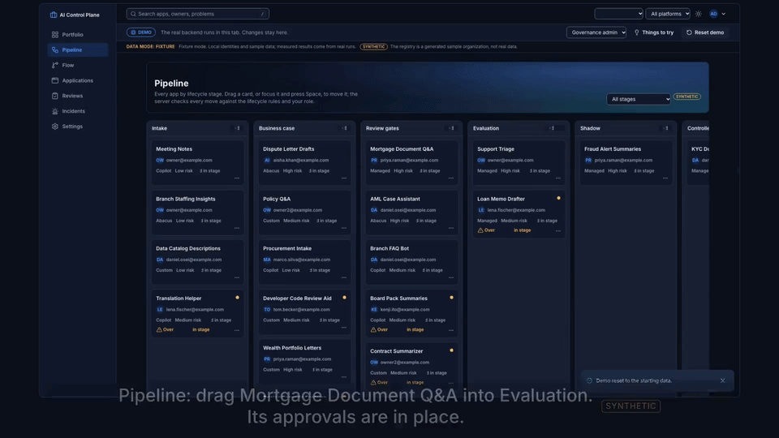</a>
  <br><sub>60-second product preview · click for the four-minute walkthrough</sub>
</p>

---

## Google Cloud architecture

Built and deployed on Google Cloud: **BigQuery, Firestore, Cloud Run (service and jobs), Identity-Aware Proxy, Vertex AI (Gemini), Cloud Storage, Cloud Scheduler, Cloud Build, Artifact Registry, and IAM** with least-privilege service accounts. It was deployed, smoke-tested through IAP, recorded, and torn down the same day; `scripts/deploy_gcp.sh` rebuilds it. Every diagram below is a draw.io file drawn with Google's official icons; click one for full size, or open the [`.drawio` sources](docs/diagrams/).

### 1. The data: BigQuery schema

Eight tables in the `control_plane` dataset, every column from [`infra/bigquery.sql`](infra/bigquery.sql). Each fact table is partitioned by `event_date`, clustered by `app_id`, and merged on `event_id`, so a nightly re-export never double-counts. Lines are the joins the analytics queries use: every table reaches the app dimension (`app_snapshots`) through `app_id`; experiment results join the budget ledger through `experiment_id`.

<p align="center">
  <a href="docs/diagrams/12_bigquery_schema.png">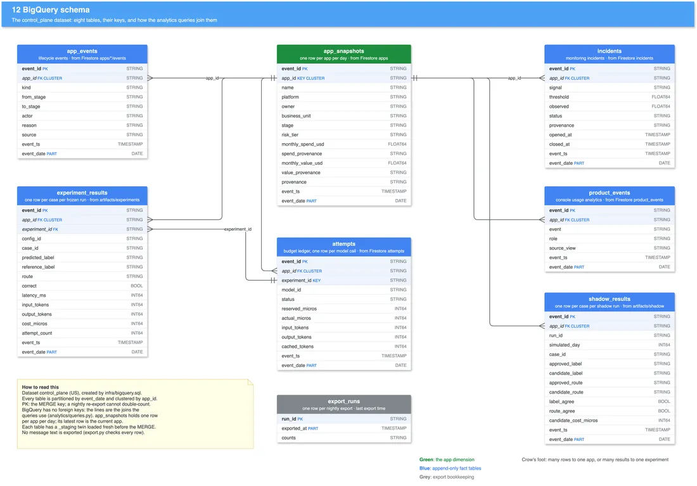</a>
</p>

### 2. Where the data comes from: lineage

Five Firestore collections and two sets of committed evaluation artifacts feed BigQuery through one nightly Cloud Run job: JSONL to Cloud Storage, load into a `_staging` table, then `MERGE`. The right column shows what reads each table; users, releases, reviews, notes, and message text never leave Firestore.

<p align="center">
  <a href="docs/diagrams/13_data_lineage.png">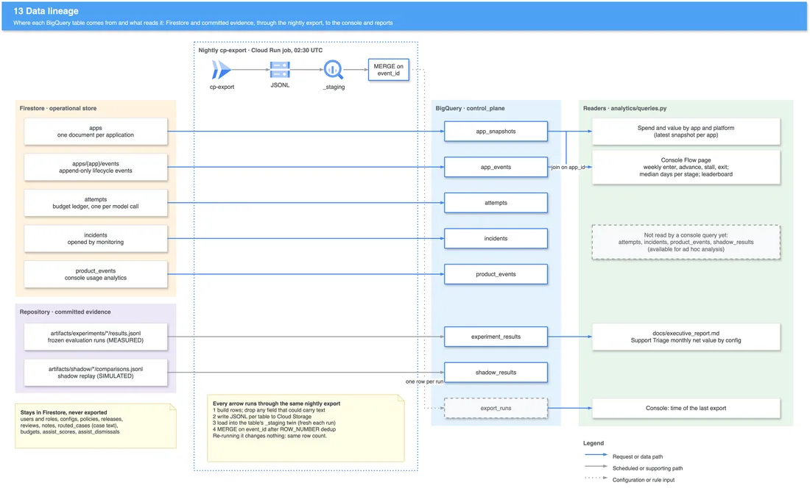</a>
</p>

### 3. The system on Google Cloud

People reach the console only through Identity-Aware Proxy; the FastAPI service on Cloud Run re-verifies every signed assertion. Cloud Run jobs evaluate models on Vertex AI, replay shadow traffic, monitor, and export; Cloud Scheduler runs monitoring and export nightly.

<p align="center">
  <a href="docs/diagrams/01_system_overview.png">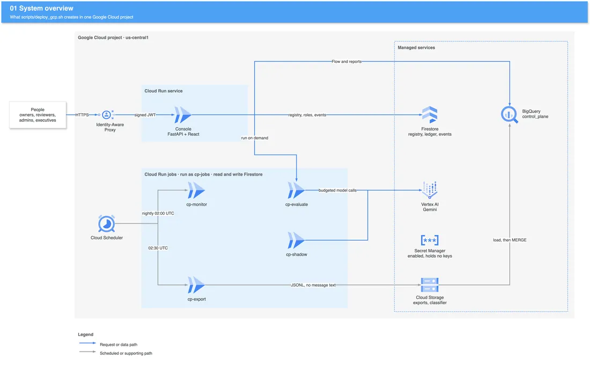</a>
</p>

### 4. Request path, identity, and spend

<table>
  <tr>
    <td width="50%"><a href="docs/diagrams/02_triage_request_path.png">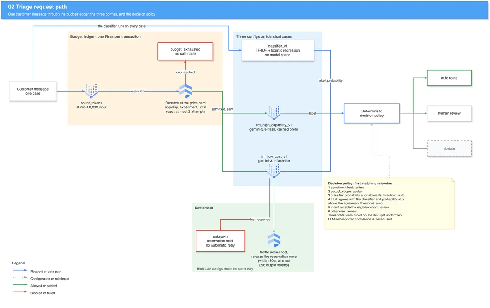</a><br><sub><b>Request path:</b> one customer message through the budget reservation, three model configurations, the deterministic routing policy, and settlement.</sub></td>
    <td width="50%"><a href="docs/diagrams/04_identity_and_access.png">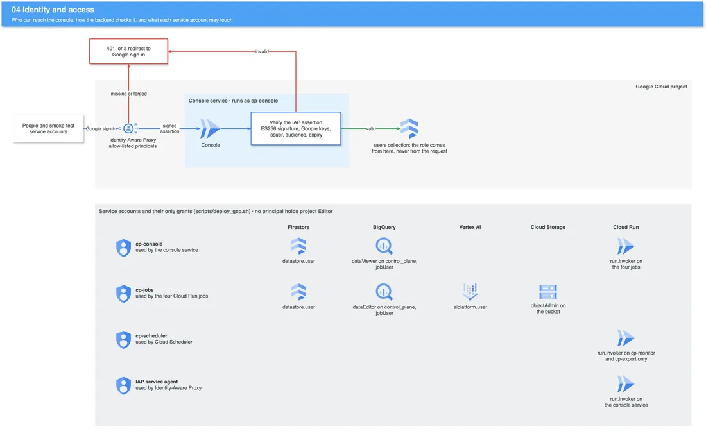</a><br><sub><b>Identity and access:</b> IAP JWT verification, roles read from Firestore, and the only grants each service account holds. No principal has project Editor.</sub></td>
  </tr>
  <tr>
    <td><a href="docs/diagrams/05_budget_ledger.png">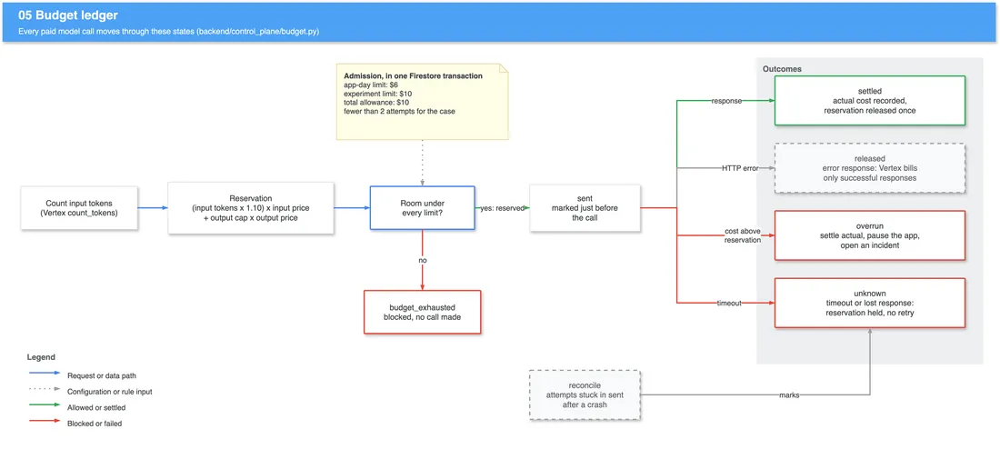</a><br><sub><b>Budget ledger:</b> every paid Vertex AI call reserves money in a Firestore transaction first; lost responses are held, never retried.</sub></td>
    <td><a href="docs/diagrams/07_analytics_pipeline.png">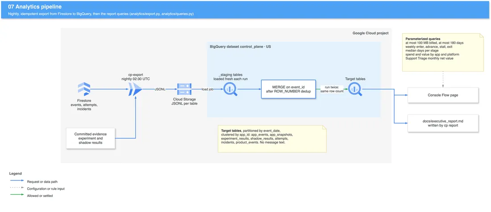</a><br><sub><b>Analytics pipeline:</b> the idempotent export and the parameterized queries (100 MB billing cap, 180-day range).</sub></td>
  </tr>
</table>

### 5. Decisions, operations, and delivery

<table>
  <tr>
    <td width="50%"><a href="docs/diagrams/06_experiment_to_release.png">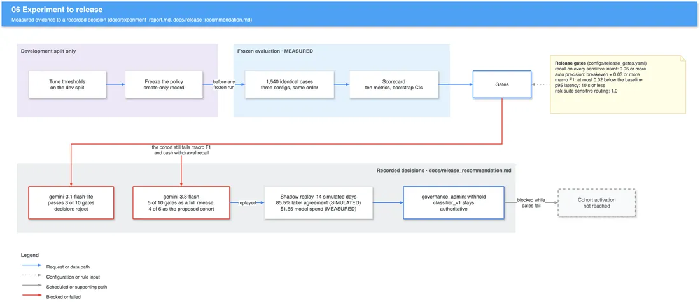</a><br><sub><b>Experiment to release:</b> how 1,540 frozen cases and the release gates produced the recorded decision.</sub></td>
    <td width="50%"><a href="docs/diagrams/08_monitoring_and_incident.png">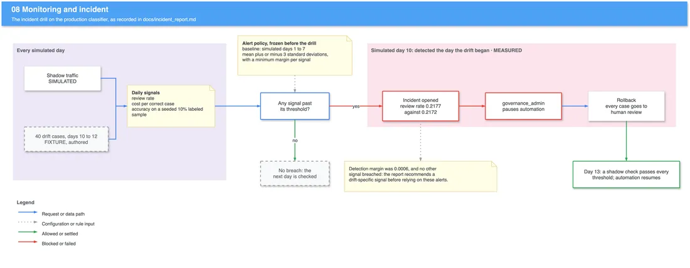</a><br><sub><b>Monitoring and incident:</b> the drift drill from detection on day 10 to recovery on day 13.</sub></td>
  </tr>
  <tr>
    <td><a href="docs/diagrams/03_registry_lifecycle.png">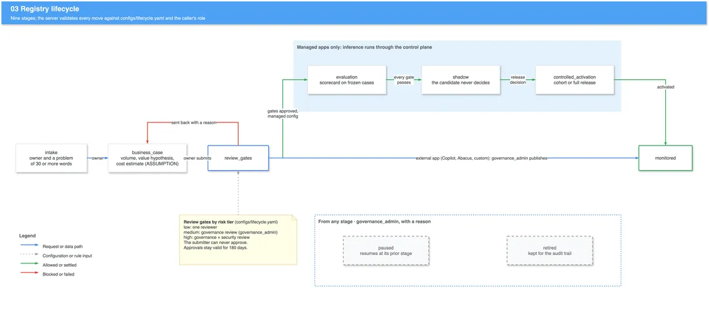</a><br><sub><b>Registry lifecycle:</b> nine stages, gates by risk tier, and the managed versus external branch.</sub></td>
    <td><a href="docs/diagrams/09_delivery.png">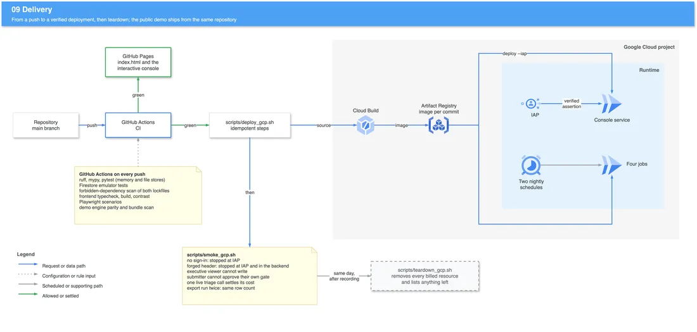</a><br><sub><b>Delivery:</b> CI, Cloud Build and Artifact Registry, deploy behind IAP, smoke checks, and teardown.</sub></td>
  </tr>
  <tr>
    <td><a href="docs/diagrams/11_public_demo.png">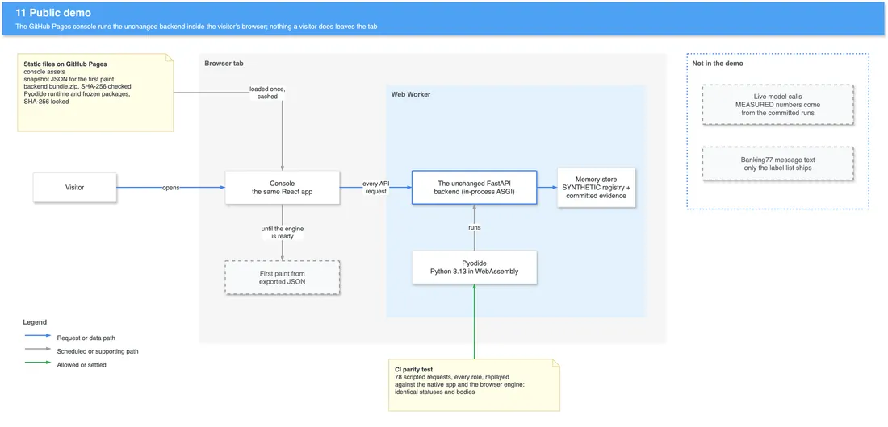</a><br><sub><b>Public demo:</b> the same backend runs in the visitor's browser (Pyodide), held to the server by a parity test.</sub></td>
    <td><a href="docs/diagrams/10_local_development.png">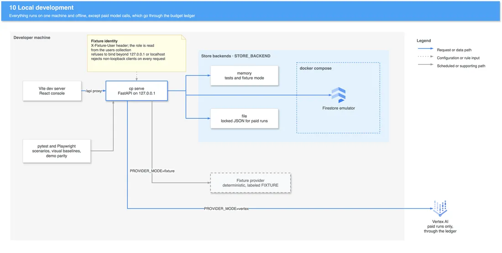</a><br><sub><b>Local development:</b> everything offline except paid model calls, which go through the ledger.</sub></td>
  </tr>
</table>

## Why

An enterprise can have dozens of AI applications across Copilot, Abacus, and custom platforms, each with a different owner, cost model, and approval trail. A successful prototype answers very little about whether the application deserves funding, whether its model can handle sensitive cases, or who should intervene when operating signals change.

This control plane connects those decisions. The **portfolio layer** tracks ownership, investment, risk, and lifecycle across a synthetic 40-app organization. The **managed-app layer** owns evaluation, routing policy, release gates, budget enforcement, and monitoring for applications whose inference runs through the system. External applications stay in the registry without pretending their inference is under its control.

**Support Triage is the worked case:** three configurations evaluated on the same 1,540 cases, two LLM candidates stopped by release gates, and a drift drill that exercised pause and recovery on the retained classifier.

## How it works

| | Step | What the system does |
|:-:|---|---|
| 1 | **Register** | Give every application an owner, platform, business problem, risk tier, lifecycle stage, and review date. |
| 2 | **Prioritize** | Compare spend with estimated value, inspect the investment matrix, and surface stalled or unattended applications. Business assumptions remain visible. |
| 3 | **Review** | Enforce approvals by risk tier. A submitter cannot approve their own gate; high-risk applications require governance and security approval. |
| 4 | **Evaluate** | Freeze the configuration and policy, compare candidates on a pinned dataset, and inspect per-intent quality, routing, latency, and cost. Reserve inference budget before a paid call. |
| 5 | **Decide** | Test full-candidate and cohort release gates. A governance admin records the decision and rationale. Failed gates block activation. |
| 6 | **Operate** | Replay shadow traffic, freeze alert thresholds, monitor the authoritative configuration, and record incident response, pause, rollback, and recovery. |

The [experiment-to-release diagram](#5-decisions-operations-and-delivery) shows steps 4 and 5 end to end.


<details>
<summary><b>One release decision, step by step</b> — Support Triage / Gemini 3.8 Flash</summary>

<br>

| Step | Recorded evidence |
|---|---|
| Freeze | `llm_high_capability_v1`, model `gemini-3.8-flash`, and `policy_llm_high_capability_v1`; policy frozen before the evaluation. |
| Evaluate | The same **1,540 cases** as the classifier: macro F1 **0.885**, auto-routed precision **0.976**, p95 latency **3,531 ms**. `MEASURED` |
| Gate | **5 of 10** full-candidate gates passed. Macro F1 missed the **0.893** floor; four sensitive intents missed **0.95** recall, with a lowest recall of **0.60**. `MEASURED` |
| Scope | Excluding the four failing intents left a 73-intent cohort. It still passed only **4 of 6** gates: macro F1 **0.889** and cash-withdrawal recall **0.90** remained below their floors. `MEASURED` |
| Shadow | **85.5%** label agreement over **14 simulated days**; **$1.65** actual model spend; **+$151** projected cohort net value. Agreement `SIMULATED`, spend `MEASURED`, value `ASSUMPTION`. |
| Decide | **Withhold.** Governance admin recorded the rationale; `classifier_v1` stayed authoritative. |
| Invest next | Remediate sensitive-intent confusion and re-evaluate. Investigate an out-of-scope guard as a narrower LLM role. |

[Release record](artifacts/releases/rel_llm_high_capability_v1_20261012T040607Z.json) · [Full recommendation](docs/release_recommendation.md)

</details>

## Results

### Model quality and the release decision

Banking77 has 77 intent labels. The frozen set contains 20 cases per label, shuffled with seed 42. Every configuration saw the same cases. Policies were tuned on development data and frozen before the evaluation; each configuration has one recorded frozen-set run.

| Metric | Classifier baseline | Gemini 3.8 Flash | Gemini 3.1 Flash Lite |
|---|---:|---:|---:|
| Macro F1 | **0.913** | 0.885 | 0.839 |
| Precision on auto-routed cases | 0.944 | **0.976** | 0.974 |
| Automation coverage | **86.2%** | 79.4% | 76.5% |
| Review rate | **13.8%** | 20.5% | 22.8% |
| p95 latency | **2 ms** | 3,531 ms | 1,382 ms |
| Model cost / 1,000 cases, list price | **$0.0000** | $1.0655 | $1.0139 |
| Full-candidate release gates | Retained baseline | 5 / 10 | 3 / 10 |
| Recorded outcome | **Authoritative** | **Withhold** | **Reject** |

Quality, routing rates, latency, and model cost are `MEASURED`. Classifier model cost excludes compute infrastructure. Retaining the baseline does not certify it against every candidate gate: its own sensitive-intent weaknesses remain in the report.

The tradeoff is statistically visible. For Gemini 3.8 Flash, paired bootstrap against the classifier gives a macro-F1 delta of **−0.028 [−0.047, −0.010]** and an auto-precision delta of **+0.033 [+0.021, +0.045]** (95% intervals, 1,000 resamples). Higher precision came with lower coverage and worse overall intent quality. [Experiment report](docs/experiment_report.md)

### Economics: a better projection still does not clear the gate

At an **assumed 50,000 cases per month**, the model combines measured routing outcomes with assumed labor, review, misroute, and infrastructure costs.

| Configuration | Projected net monthly value | Difference from classifier |
|---|---:|---:|
| Classifier | $57,270 | — |
| Gemini 3.8 Flash | $66,957 | +$9,687 |
| Gemini 3.1 Flash Lite | $62,130 | +$4,860 |

**Every dollar figure in this table is `ASSUMPTION`, not realized savings.** Gemini 3.8 Flash has the highest projected value under the stated inputs, yet the release remains withheld. The business case includes breakeven precision and sensitivity to misroute cost and review time. [Business case](docs/business_case.md) · [Inputs](configs/business_model.yaml)

### Recovery: an exercised path, with a documented weakness

The drill injected **40 authored drift cases** on simulated days 10–12 while the classifier remained authoritative. Alert thresholds were frozen from days 1–7 before the drill.

| Simulated day | Signal or action |
|---|---|
| **10** | Review rate reached **0.2177** against a **0.2172** threshold; monitoring opened an incident. |
| **10** | Governance admin paused automation and rolled back to human review for every case. |
| **13** | A shadow check passed all thresholds; automation was resumed. |

**The weak spot:** detection crossed the threshold by only **0.0006**, using unrounded values, and no other signal breached on day 10. The classifier also auto-routed one sensitive paraphrase. In shadow, the LLM recognized all 20 out-of-domain drift cases, suggesting a narrower guard role worth testing. Traffic is `SIMULATED`; injected cases are `FIXTURE` and were labeled by one rater. [Incident report](docs/incident_report.md)

## The console

The React + TypeScript console follows the same application from portfolio investment to operational response. Screens below are actual interface captures; click to open them at full size.

<table>
  <tr>
    <td width="50%"><a href="assets/web/screens/portfolio.webp">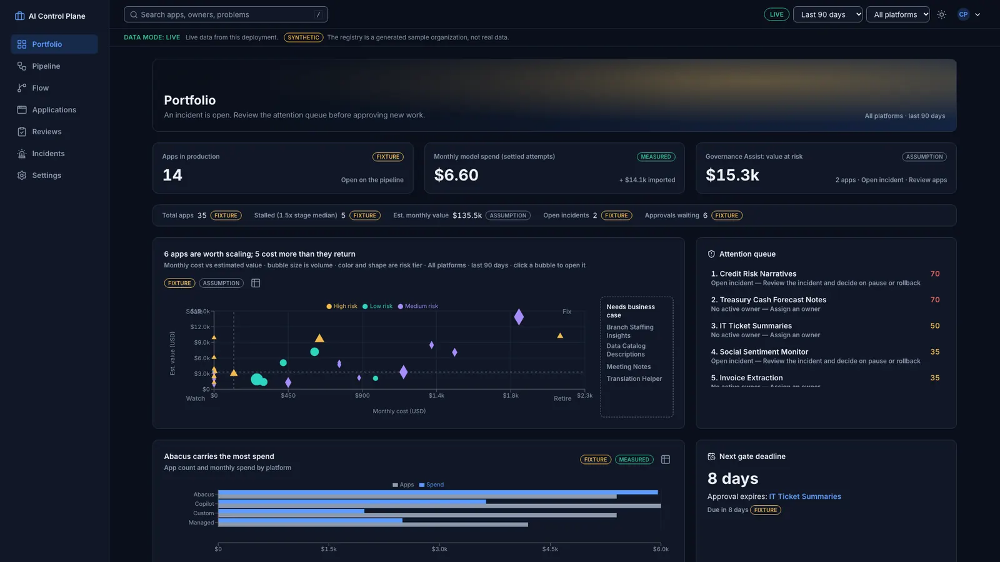</a><br><sub><b>Portfolio:</b> investment matrix, spend and value, and an attention queue that names the next decision.</sub></td>
    <td width="50%"><a href="assets/web/screens/pipeline.webp">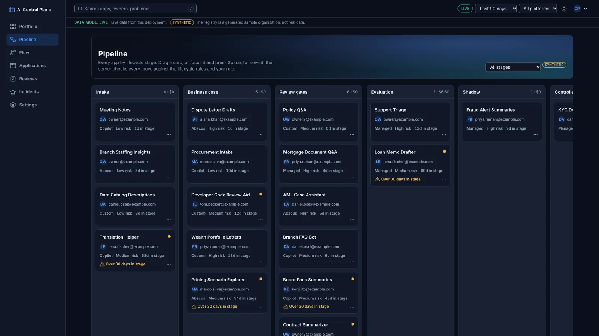</a><br><sub><b>Pipeline:</b> nine lifecycle stages; mouse and keyboard moves validated by the server.</sub></td>
  </tr>
  <tr>
    <td><a href="assets/web/screens/triage-experiments.webp">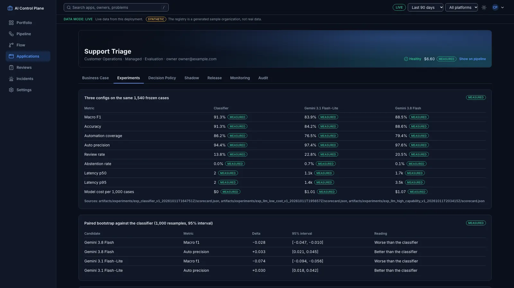</a><br><sub><b>Experiments:</b> per-intent results, paired comparisons, confidence intervals, latency, and cost.</sub></td>
    <td><a href="assets/web/screens/triage-release.webp">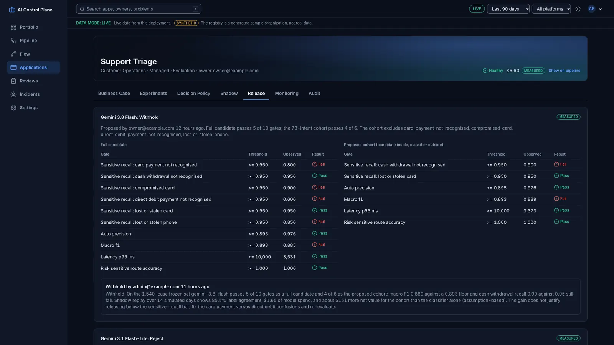</a><br><sub><b>Release:</b> observed versus required performance, failed gates, and the accountable decision.</sub></td>
  </tr>
  <tr>
    <td><a href="assets/web/screens/triage-monitoring.webp">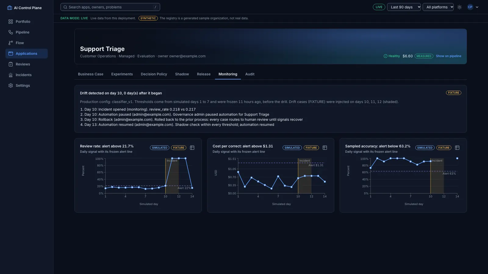</a><br><sub><b>Monitoring:</b> daily signals against frozen alert lines, with the incident marked.</sub></td>
    <td><a href="assets/web/screens/incidents.webp">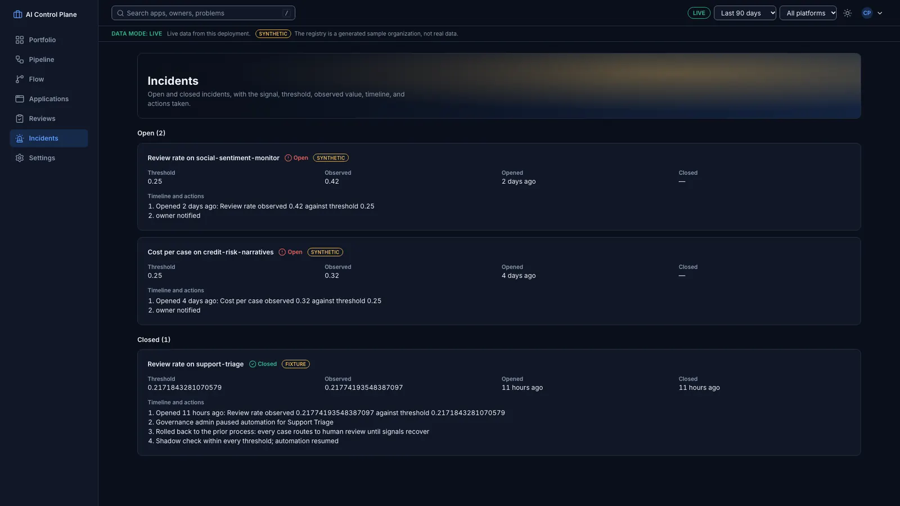</a><br><sub><b>Incidents:</b> detection, pause, rollback to human review, and recovery.</sub></td>
  </tr>
</table>

<details>
<summary><b>Flow analytics, business case, and decision policy</b></summary>

<br>

| Screen | Decision it supports |
|---|---|
| [Flow analytics](assets/web/screens/flow.webp) | Where are applications entering, progressing, stalling, or exiting? |
| [Business case](assets/web/screens/triage-business.webp) | How does changing review time or error cost change breakeven precision and net value? |
| [Decision policy](assets/web/screens/triage-policy.webp) | Which intents are eligible for a cohort, and does that scope actually pass the release gates? |

The console also includes the application registry, independent review queue, application notes and audit history, role administration, and CSV import/export. Governance Assist uses explicit, deterministic signals to explain why an application needs attention.

</details>

**Try a decision:** open the [pipeline](https://abh2050.github.io/enterprise-ai-control-plane/console/#/pipeline) and attempt a move with missing requirements; inspect Support Triage's [release gates](https://abh2050.github.io/enterprise-ai-control-plane/console/#/apps/support-triage?tab=release); switch to an executive viewer and observe the permissions.

The public demo runs the **same Python backend in Pyodide**. A 78-request parity scenario compares status codes and normalized response bodies with the native API, including rejected writes and blocked activation. Local changes can be reset; model responses use fixtures, and no paid inference occurs in the visitor's browser. [Parity test](tests/test_demo_parity.py)

## Data ontology

The ontology is the product's **shared vocabulary and relationship model**. It connects ownership, versioned evidence, constraints, decisions, and operations, so the portfolio and the release scorecard describe the same application.

For one release, the useful questions are concrete: **which application, which candidate and baseline, which policy, which evaluation dataset, which observed gate results, and whose decision?** The answers are explicit IDs and typed records in [contracts.py](backend/control_plane/contracts.py).

| Entity | What it establishes |
|---|---|
| **Application** | Ownership, business unit, platform, risk tier, lifecycle stage, business assumptions, and the authoritative `active_config_id`. |
| **Configuration → Policy** | Exact model/version, prompt hash, limits, price card, and the policy's thresholds, sensitive intents, and eligible cohort. |
| **Experiment → Configuration + Dataset** | Which version was evaluated against which source, commit, SHA256, split, and seed. Per-case results retain prediction, route, correctness, latency, tokens, and cost. |
| **Release → Application + Configurations + Policy** | Candidate and baseline, scorecard, gate results, cohort, decision, rationale, actor, and time. |
| **ShadowRun / Incident** | Which configurations were compared; which application's signal breached; threshold, observation, actions, and recovery status. |
| **Review / AppEvent** | Which gate or case was reviewed, by whom, and why; application changes with actor, reason, and evidence references. |
| **Attempt → Budget** | Which application, experiment, case, and model consumed a reservation, and which budgets must be settled. |

<details>
<summary><b>Explore the core record relationships</b></summary>

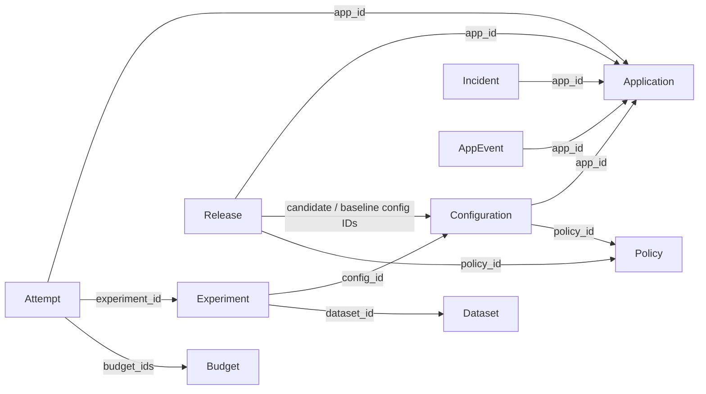

Arrows name record references. This is a typed domain model implemented with Pydantic and explicit IDs. Experiment evidence is assembled into release scorecards; a release does not pretend to have a foreign key to every evidence record.

</details>

### Provenance travels with the number

A `Metric` requires **value, unit, provenance, and source**. For example, the actual candidate scorecard records:

```json
{
  "macro_f1": {
    "value": 0.8854739159324452,
    "unit": "ratio",
    "provenance": "MEASURED",
    "source": "artifacts/experiments/exp_llm_high_capability_v1_20261011T203415Z/results.jsonl"
  }
}
```

| Provenance | Meaning here |
|---|---|
| `MEASURED` | Observed model performance and actual API spend |
| `SIMULATED` | Shadow replay and operating signals from simulated traffic |
| `FIXTURE` | Authored drift cases and demo responses |
| `ASSUMPTION` | Business volumes, unit costs, and projected value |

Dataset labels such as `SYNTHETIC` and `AUTHORED` describe data origin separately. Pydantic rejects unknown record fields; provenance is a required contract, not an optional chart annotation. [Inspect the scorecard](artifacts/experiments/exp_llm_high_capability_v1_20261011T203415Z/scorecard.json) · [Explore the interactive ontology](https://abh2050.github.io/enterprise-ai-control-plane/#ontology)

### Operational records become analytical lineage

Firestore records and committed evaluation artifacts export as JSONL to Cloud Storage, load into BigQuery staging tables, and merge by stable `event_id`. Repeated exports do not inflate totals. The analytical tables retain application, configuration, experiment, and case IDs; raw message and note text are excluded.

[Lineage diagram](#2-where-the-data-comes-from-lineage)

Seven event-based tables are partitioned by `event_date` and clustered by `app_id`; `export_runs` records export history separately. Queries use named parameters, a 180-day range cap, and a 100 MB billing cap. [Physical schema](docs/diagrams/12_bigquery_schema.png) · [SQL](infra/bigquery.sql) · [Export code](backend/control_plane/analytics/export.py)

## Tech stack


| Layer | Implementation |
|---|---|
| **Product** | React, TypeScript, TanStack Query, Recharts; keyboard-accessible workflows and dark/light themes |
| **API and domain** | FastAPI, Pydantic, Python CLI; lifecycle rules, roles, policy, release evaluation, and provenance |
| **Inference** | TF-IDF + calibrated logistic regression; Gemini through Vertex AI; deterministic `auto` / `review` / `abstain` routing |
| **Operational data** | Firestore; memory and durable file stores for local workflows |
| **Analytics** | Cloud Storage → BigQuery staging → idempotent MERGE → portfolio/report queries |
| **Cloud runtime** | Cloud Run service behind Identity-Aware Proxy; separate service accounts for console, jobs, and scheduler |
| **Automation** | Cloud Run Jobs and Cloud Scheduler for evaluation, shadow, monitoring, and export |
| **Delivery and demo** | GitHub Actions; Cloud Build and Artifact Registry; GitHub Pages with the Python backend in a Pyodide worker |

The Google Cloud deployment was **deployed, smoke-tested through IAP, and then torn down**. The public project site and interactive browser demo remain available. The deployment script provisions the cloud resources; this README does not imply that a live paid backend is still running.

[All 13 architecture diagrams](docs/diagrams/README.md) · [Identity boundary](docs/diagrams/04_identity_and_access.png) · [Request path](docs/diagrams/02_triage_request_path.png) · [Public demo runtime](docs/diagrams/11_public_demo.png)

## Controls that are enforced

| Boundary | Enforcement | Evidence |
|---|---|---|
| **Identity** | Verify IAP JWT signature, issuer, audience, and expiry; resolve roles from stored users. Fixture identity is loopback-only. | [IAP tests](tests/test_iap.py), [identity tests](tests/test_identity.py) |
| **Approval** | Risk-tier gates, independent review, ownership checks, and optimistic version checks on lifecycle moves. | [Lifecycle tests](tests/test_lifecycle.py) |
| **Release** | Failed full-candidate or cohort gates block activation; only a governance admin can record the release decision. | [Release tests](tests/test_release.py) |
| **Spend** | Reserve integer microdollars before inference; settle once; retain reservations for uncertain outcomes; pause on an overrun. | [Budget tests](tests/test_budget.py) |
| **Routing** | Sensitive predictions go to review; out-of-scope predictions abstain; agreement and classifier probability govern automation. LLM self-reported confidence is unused. | [Policy implementation](backend/control_plane/triage/policy.py), [tests](tests/test_policy.py) |
| **Record history** | Configurations, policies, reviews, and app events reject update, overwrite, delete, and transactional replacement through the store. | [Immutability tests](tests/test_immutability.py) |
| **Export and demo** | Analytics excludes raw message/note text; the demo bundle excludes Banking77 message files and credentials. | [Export tests](tests/test_export.py), [bundle tests](tests/test_demo_bundle.py) |

Create-only behavior is an application guarantee; a direct database administrator can alter records. The test suite exercises controls and failure paths, and the CI badge links to the current run rather than claiming a penetration-test result.

## Run it

For local development, install [uv](https://docs.astral.sh/uv/) and Node 22 (the CI version). The Python project targets 3.12; `uv sync` uses the pinned interpreter. Docker is optional for the Firestore emulator.

```bash
uv sync
uv run cp serve                 # API: http://127.0.0.1:8000
```

In a second terminal:

```bash
cd frontend
npm ci
npm run dev                     # console: http://127.0.0.1:5173
```

Pick a fixture identity in the header. The default memory store requires no cloud credentials. Fixture mode refuses non-local binds and rejects non-loopback clients.

<details>
<summary><b>Firestore emulator</b></summary>

```bash
docker compose up -d firestore
export STORE_BACKEND=firestore FIRESTORE_EMULATOR_HOST=127.0.0.1:8080
uv run cp seed-registry          # SYNTHETIC registry plus the committed evidence
uv run cp serve
```

</details>

<details>
<summary><b>Reproduce the classifier evaluation</b></summary>

Banking77 (PolyAI, CC BY 4.0) is pinned by commit and SHA256 in [data/manifest.json](data/manifest.json). Citation: Casanueva et al. (2020), *Efficient Intent Detection with Dual Sentence Encoders*.

```bash
uv run cp data fetch              # verify hashes, headers, and the 77 labels
uv run cp data split              # seed 42; split files hold row IDs only
uv run cp train                   # TF-IDF + logistic regression, calibrated on dev
uv run cp freeze classifier_v1    # create-only config and policy, tuned on dev
uv run cp evaluate classifier_v1  # frozen set; reruns require --rerun-reason
uv run cp experiment-report
```

Existing measured LLM artifacts are committed under [artifacts/experiments](artifacts/experiments/). Paid Vertex AI runs require cloud authentication and budget configuration; the local quick start uses the fixture provider.

</details>

<details>
<summary><b>Checks and static-page preview</b></summary>

From the repository root:

```bash
uv run ruff check .
uv run ruff format --check .
uv run mypy
uv run pytest
FIRESTORE_EMULATOR_HOST=127.0.0.1:8080 uv run pytest  # adds emulator variants
```

From `frontend/`:

```bash
npm run typecheck
npm run build
npm run contrast
npm run e2e                     # includes demo builds; requires Playwright Chromium
```

Preview the project page from the repository root:

```bash
python3 -m http.server 8773 --bind 127.0.0.1
```

Open `http://127.0.0.1:8773/`. CI covers Python lint/typing/tests, Firestore immutability, frontend builds, browser scenarios, contrast, and native/Pyodide parity. See [ci.yml](.github/workflows/ci.yml).

</details>

<details>
<summary><b>Cloud deployment scripts and repository map</b></summary>

Cloud deployment requires a billed GCP project, suitable permissions, authenticated `gcloud`/`bq`, and the IAP OAuth setup described in [decisions D33–D36](docs/decisions.md#d33-cloud-run-with-iap-enabled-directly-smoke-checks-through-iap-as-service-accounts-m6). Inspect [deploy_gcp.sh](scripts/deploy_gcp.sh), [smoke_gcp.sh](scripts/smoke_gcp.sh), and [teardown_gcp.sh](scripts/teardown_gcp.sh) for provisioning, verification, and cleanup. Deployment and inference incur cloud charges.

| Path | What lives here |
|---|---|
| `backend/control_plane/` | API, typed ontology, identity, lifecycle, ledger, monitoring, CLI, and store backends |
| `backend/control_plane/triage/` | Classifier, LLM evaluation, routing, scorecards, gates, activation, and shadow replay |
| `backend/control_plane/analytics/` | Export, BigQuery queries, and executive reports |
| `frontend/` | React console, browser engine integration, and Playwright scenarios |
| `configs/` | Lifecycle rules, release gates, business assumptions, model configurations, and price cards |
| `data/` | Dataset manifest, split IDs, authored risk suite, and drift cases |
| `artifacts/` | Evaluation results, frozen policies, releases, shadow, monitoring, and incidents |
| `infra/`, `scripts/` | SQL schema, cloud deployment, smoke checks, teardown, and demo/asset builders |
| `docs/` | Reports, engineering decisions, console specification, diagrams, and media provenance |
| `index.html`, `console/`, `media/` | Published project page, interactive demo, and films |

</details>

## Limits and next investment

The 40-app portfolio is synthetic. Measured model results come from Banking77, and both the 60-case risk suite and 40-case drift set were authored by one rater. Shadow traffic is simulated; projected value uses stated assumptions. The classifier remains imperfect, and the drill's narrow detection margin limits what can be concluded about monitoring robustness.

The next work follows those findings: **fix sensitive-intent confusion; evaluate an out-of-scope guard; add a drift-specific signal; and validate labels and operating assumptions with independent reviewers and representative traffic.** These are proposed improvements, not shipped capabilities. [Executive recommendation](docs/executive_report.md)

## Docs

| Read | What it substantiates |
|---|---|
| [Experiment report](docs/experiment_report.md) | Frozen-set comparison, bootstrap intervals, usage, cost, and sensitive-intent weaknesses |
| [Release recommendation](docs/release_recommendation.md) | Full and cohort gates, recorded verdicts, and shadow economics |
| [Business case](docs/business_case.md) | Breakeven precision, projected value, and sensitivity to assumptions |
| [Incident report](docs/incident_report.md) | Frozen alert policy, drift injection, response timeline, and detection limits |
| [Executive report](docs/executive_report.md) | Portfolio findings and the next investment decision |
| [Architecture diagrams](docs/diagrams/README.md) | Runtime, identity, lifecycle, ledger, release, analytics, delivery, schema, and lineage |
| [Engineering decisions](docs/decisions.md) | Alternatives, tradeoffs, and deviations from the intended scenario |
| [Console specification](docs/spec/console_spec.md) | Product behavior and interaction requirements |

---

<sub>Designed and built by <a href="https://github.com/abh2050">Abhishek Shah</a>. The project page uses Higgsfield-generated artwork; interface captures and architecture diagrams document the implementation. <a href="docs/asset_manifest.md">Media provenance</a> · <a href="assets/generated/manifest.json">Generation records</a>.</sub>
