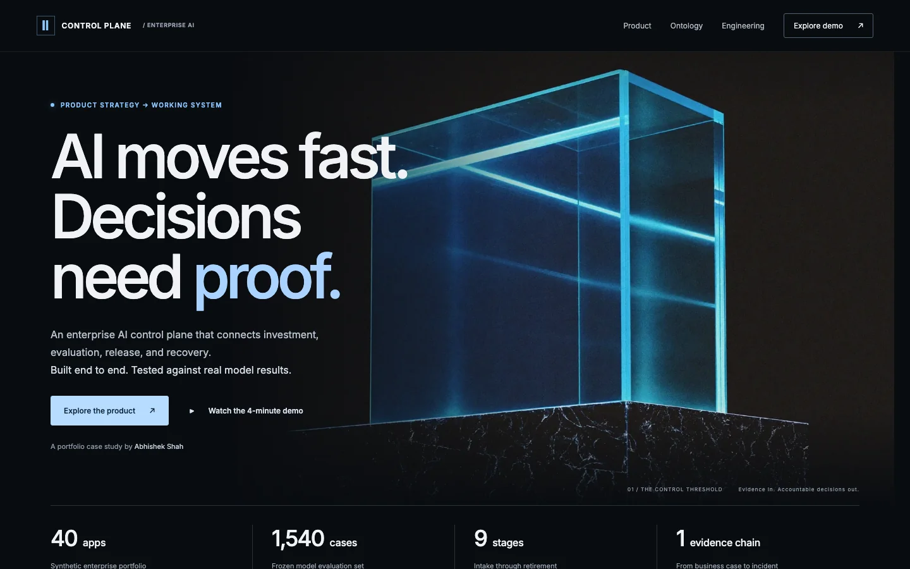
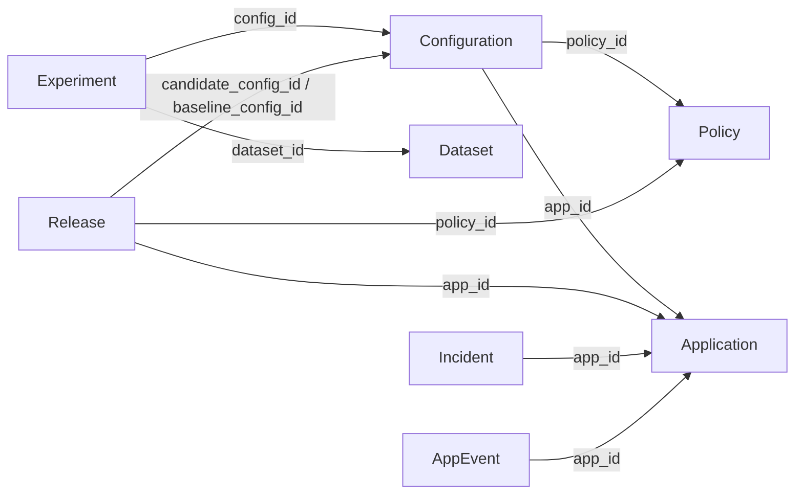

# Enterprise AI Control Plane

**AI moves fast. Decisions need proof.**

An end-to-end product and engineering case study by [Abhishek Shah](https://github.com/abh2050): a control plane that connects AI investment, model evaluation, release authorization, and incident recovery through a shared data ontology.

[Explore the project](https://abh2050.github.io/enterprise-ai-control-plane/) · [Try the interactive demo](https://abh2050.github.io/enterprise-ai-control-plane/console/) · [Watch the 4-minute walkthrough](https://abh2050.github.io/enterprise-ai-control-plane/#watch) · [Read the release recommendation](docs/release_recommendation.md)

[](https://abh2050.github.io/enterprise-ai-control-plane/)

## The decision that matters

The system's most important outcome was **withholding the LLM**.

Three configurations were evaluated on the same **1,540 frozen Banking77 cases**. Gemini 3.8 Flash improved auto-routed precision, but failed the macro-F1 floor and four sensitive-intent recall gates. A narrower cohort still failed two of six gates. The recorded decision kept the classifier authoritative.

| Configuration                                  | Macro F1, measured | Release outcome                               |
| ---------------------------------------------- | -----------------: | --------------------------------------------- |
| TF-IDF + logistic regression (`classifier_v1`) |              0.913 | Retained as the authoritative baseline        |
| Gemini 3.8 Flash                               |              0.885 | Withheld; passed 5 of 10 full-candidate gates |
| Gemini 3.1 Flash Lite                          |              0.839 | Rejected; passed 3 of 10 full-candidate gates |

The proposed cohort projected **$151 more net value over a 14-day shadow replay**, using explicit business assumptions. That estimate did not override failed quality gates. The next investment was targeted remediation of sensitive-intent confusion, followed by re-evaluation.

Sources: [experiment report](docs/experiment_report.md), [release recommendation](docs/release_recommendation.md), [business model](docs/business_case.md).

## What you can explore

The [interactive demo](https://abh2050.github.io/enterprise-ai-control-plane/console/) runs the Python backend inside your browser with Pyodide. Changes stay local, model responses use fixtures, and no sign-in or cloud credentials are required.

| Product surface     | What it makes possible                                                                               |
| ------------------- | ---------------------------------------------------------------------------------------------------- |
| **Portfolio**       | Prioritize a synthetic 40-app portfolio using investment value, spend, risk, and an attention queue. |
| **Pipeline**        | Move applications through nine lifecycle stages with server-enforced gates and role checks.          |
| **Flow analytics**  | Inspect entries, progression, stalls, and exits across the portfolio.                                |
| **Business case**   | Examine breakeven precision and how assumed volumes and error costs change net value.                |
| **Experiments**     | Compare frozen configurations, per-intent performance, bootstrap intervals, latency, and cost.       |
| **Decision policy** | Preview cohort eligibility and its effect on release gates.                                          |
| **Release**         | Inspect thresholds, observed values, the recorded verdict, and the decision maker's rationale.       |
| **Monitoring**      | Compare operating signals against frozen alert thresholds.                                           |
| **Incidents**       | Follow detection, automation pause, rollback to human review, and recovery.                          |

## Data ontology: the connective structure

The ontology is the system's **typed domain model**: named entities, explicit relationships, lifecycle states, and provenance rules. It is implemented in [Pydantic contracts](backend/control_plane/contracts.py), with unknown fields rejected. The interactive [ontology explorer](https://abh2050.github.io/enterprise-ai-control-plane/#ontology) connects each entity to the question it helps a product owner answer.

This abbreviated relationship map shows the core evidence chain. Arrows name record references; it is a domain model, not a separate graph database.



| Entity                     | Meaning and key relationships                                                                                                                                                                    |
| -------------------------- | ------------------------------------------------------------------------------------------------------------------------------------------------------------------------------------------------ |
| **Application**            | The ownership and lifecycle anchor: owner, business unit, risk tier, stage, business case, and `active_config_id`.                                                                               |
| **Configuration + Policy** | A configuration identifies the model, version, prompt hash, limits, price card, and policy. The policy holds thresholds, sensitive intents, and the eligible cohort.                             |
| **Dataset + Experiment**   | A dataset pins source URL, commit, SHA256, split, and seed. An experiment connects `config_id` to `dataset_id`; case results record predictions, routes, correctness, latency, tokens, and cost. |
| **Release**                | Connects the application, candidate, baseline, and policy with a scorecard, observed gate results, decision, rationale, actor, and timestamp.                                                    |
| **ShadowRun + Incident**   | Shadow runs compare authoritative and candidate configurations over simulated days. Incidents attach signals, thresholds, observations, response actions, and status to an application.          |
| **Review + AppEvent**      | Reviews identify the gate or case, reviewer, decision, and reason. App events retain lifecycle changes, actor, reason, and `evidence_refs`.                                                      |
| **Attempt + Budget**       | Attempts identify the application, experiment, case, model, and affected budgets. Reservations and settlement use integer microdollars.                                                          |

### Provenance is part of the type

Every `Metric` requires `value`, `unit`, `provenance`, and `source`. A missing source is a contract error. The interface can therefore distinguish evidence from scenarios without relying on a footnote to a chart.

| Provenance   | Example                                                 |
| ------------ | ------------------------------------------------------- |
| `MEASURED`   | Frozen-set model performance and actual inference spend |
| `SIMULATED`  | Shadow traffic and replayed operating signals           |
| `FIXTURE`    | Authored drift cases and demo responses                 |
| `ASSUMPTION` | Business volumes, unit costs, and projected value       |

Dataset labels such as `SYNTHETIC` describe the origin of data separately from metric provenance. A 40-app synthetic portfolio does not become measured enterprise adoption because it appears in a dashboard.

Configurations, policies, reviews, and app events are **create-only through application code**. The memory and Firestore stores enforce this behavior; direct database administrators can still alter records. Releases retain decision fields and are not described as immutable records. See [store enforcement](backend/control_plane/store.py).

### From operational records to analytical lineage

The deployed path exports Firestore records and committed evaluation artifacts to Cloud Storage, loads BigQuery staging tables, and performs an idempotent `MERGE` by stable `event_id`. Seven event-based tables are partitioned by `event_date` and clustered by `app_id`; a separate `export_runs` table records export history. Raw message and note text are excluded from the export.

The analytical model preserves application, configuration, experiment, and case identifiers so portfolio views can be traced back to their source evidence.

[Physical BigQuery schema](docs/diagrams/12_bigquery_schema.png) · [Data lineage diagram](docs/diagrams/13_data_lineage.png) · [SQL definitions](infra/bigquery.sql) · [Export implementation](backend/control_plane/analytics/export.py)

## Engineering behind the product

- **React + TypeScript console, Python API and CLI.** Shared contracts support a local memory store, Firestore, and the browser-hosted demo.
- **Google Cloud deployment.** Cloud Run behind Identity-Aware Proxy, Firestore, Vertex AI, Cloud Run Jobs, Cloud Scheduler, Cloud Storage, and BigQuery. The deployment was verified and subsequently torn down; the public demo runs in the visitor's browser.
- **Budget enforcement before inference.** Reserve first, send, then settle actual spend once. An uncertain attempt holds its reservation instead of triggering a potentially duplicate paid call.
- **Governance enforced on the server.** Lifecycle gates, role checks, independent review, explicit release decisions, and application event history.
- **An exercised recovery path.** The simulated drift drill detected a review-rate breach on day 10, paused automation, routed cases to human review, and resumed after a passing shadow check on day 13.

[](docs/diagrams/01_system_overview.png)

[Explore all 13 diagrams](docs/diagrams/README.md) · [Engineering decision log](docs/decisions.md) · [Incident report](docs/incident_report.md)

## Local quick start

Requirements: [uv](https://docs.astral.sh/uv/), Node 20 or later, and optionally Docker for the Firestore emulator.

In one terminal:

```bash
uv sync
uv run cp serve                 # http://127.0.0.1:8000; memory store, fixture identity
```

In another terminal:

```bash
cd frontend
npm ci
npm run dev                     # http://127.0.0.1:5173
```

Pick a fixture identity in the console header. Fixture identity trusts a request header, so the server refuses to bind to anything except localhost and rejects non-loopback clients.

To preview the static project page, run `python3 -m http.server 8773 --bind 127.0.0.1` from the repository root, then open `http://127.0.0.1:8773/`.

### Firestore emulator

```bash
docker compose up -d firestore
export STORE_BACKEND=firestore FIRESTORE_EMULATOR_HOST=127.0.0.1:8080
uv run cp seed-fixture
uv run cp serve
```

### Checks

```bash
uv run ruff check . && uv run mypy && uv run pytest
FIRESTORE_EMULATOR_HOST=127.0.0.1:8080 uv run pytest   # also runs the emulator variants
cd frontend && npm run typecheck && npm run build
```

### Reproduce the classifier evaluation

Banking77 (PolyAI, CC BY 4.0) is pinned by commit and SHA256 in [data/manifest.json](data/manifest.json). Citation: Casanueva et al. (2020), _Efficient Intent Detection with Dual Sentence Encoders_.

```bash
uv run cp data fetch              # verify hashes, headers, and the 77 labels
uv run cp data split              # seed 42; split files hold row IDs only
uv run cp train                   # TF-IDF + logistic regression, calibrated on dev
uv run cp freeze classifier_v1    # create-only policy and config, tuned on dev
uv run cp evaluate classifier_v1  # frozen set; reruns require --rerun-reason
uv run cp experiment-report
```

## Evidence and limitations

The portfolio is synthetic. Banking77 results are measured. Shadow traffic is simulated, and the drift cases are authored fixtures labeled by one rater. Projected business value is assumption-based, not realized savings. The drill's detection margin was narrow, and its report explicitly identifies the need for a stronger drift-specific signal.

| Review the claim                          | Inspect the evidence                                     |
| ----------------------------------------- | -------------------------------------------------------- |
| Why retain the classifier?                | [Release recommendation](docs/release_recommendation.md) |
| How did the models compare?               | [Experiment report](docs/experiment_report.md)           |
| What assumptions drive value?             | [Business case](docs/business_case.md)                   |
| Did recovery work, and where was it weak? | [Incident report](docs/incident_report.md)               |
| Why was the system designed this way?     | [Decision log](docs/decisions.md)                        |

The landing page uses three newly generated Higgsfield Soul V2 artworks as visual metaphors. Product screens are actual interface captures; architecture diagrams reflect the implementation. Generation prompts, request IDs, and asset provenance are recorded in the [asset manifest](docs/asset_manifest.md) and [generation manifest](assets/generated/manifest.json).
